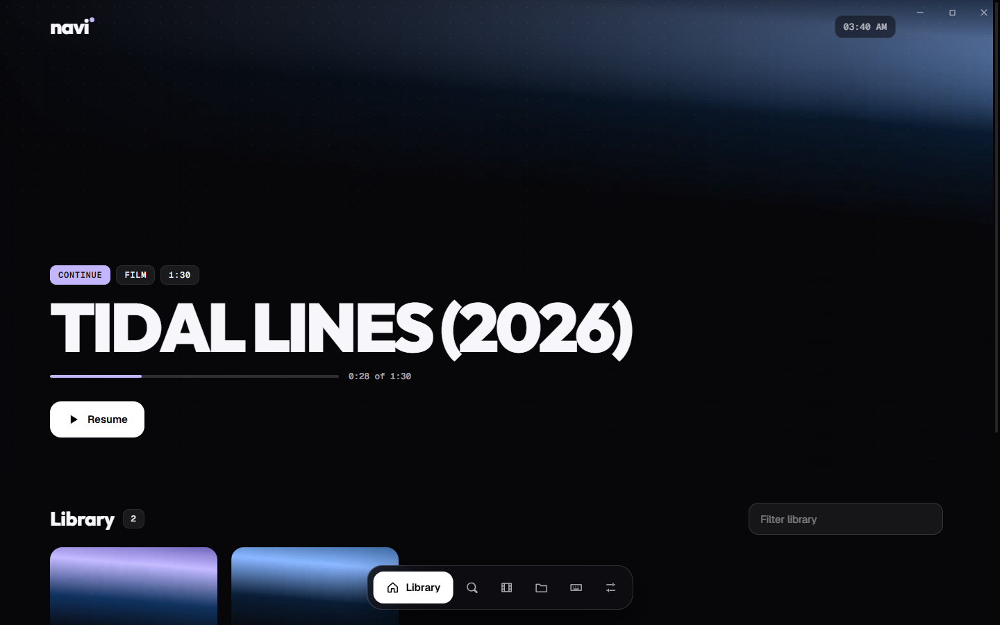
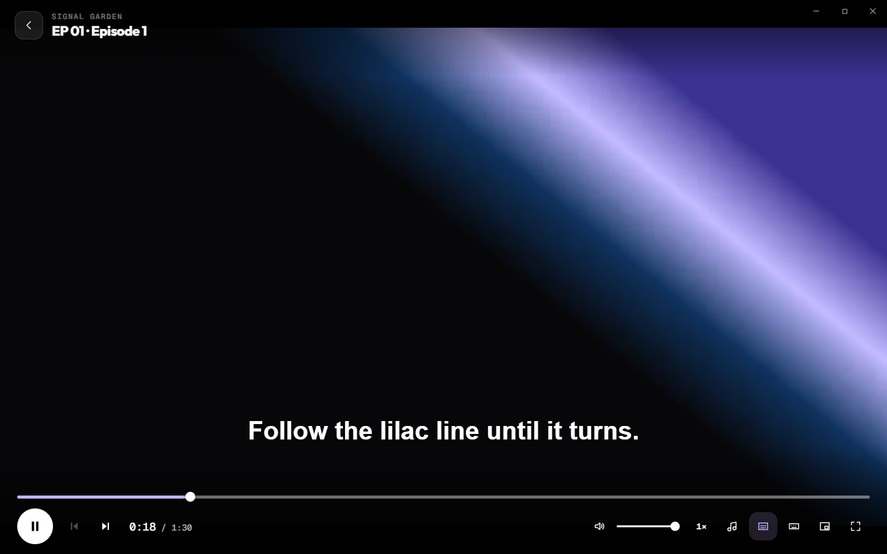
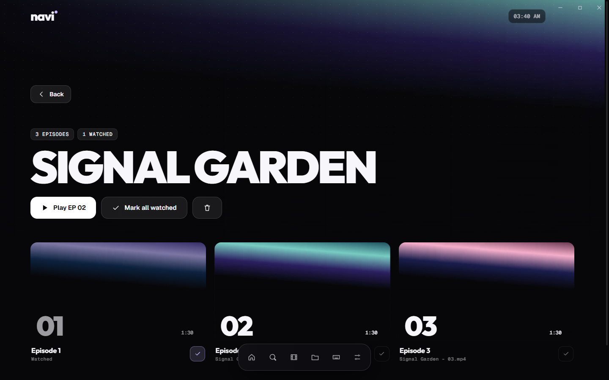
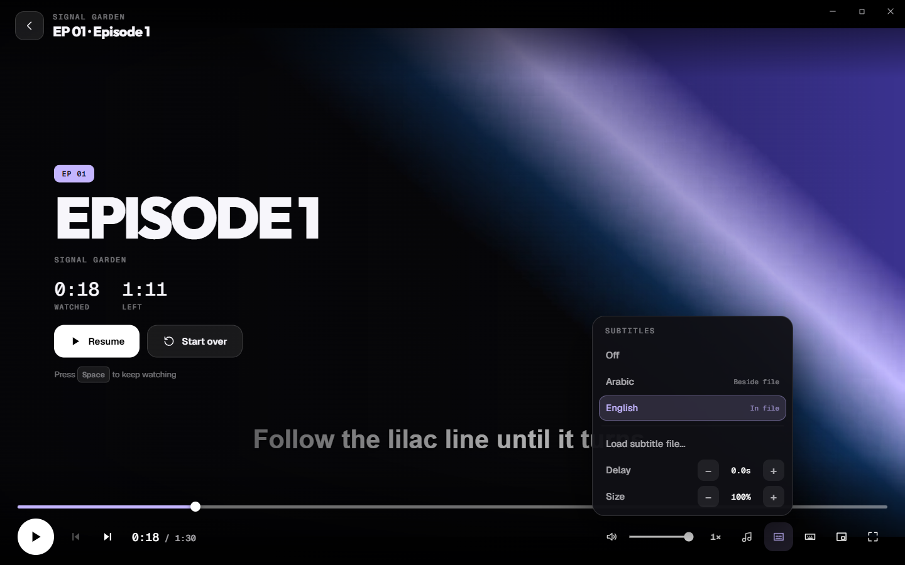
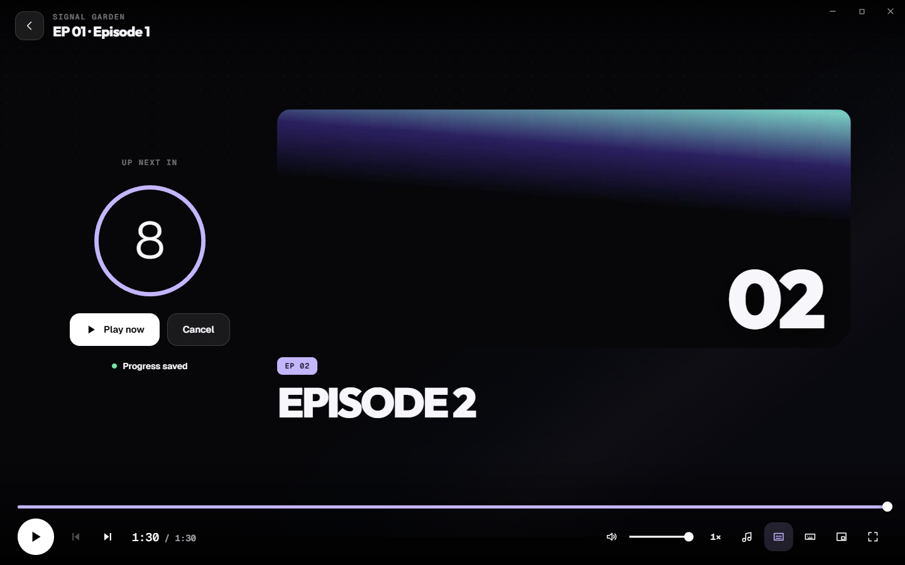

# Navi Public

Navi Public is my Windows media library and player for the videos and subtitles you already have. Point it at a file or a folder and it groups episodes, finds subtitles, and returns to the exact second you stopped. It works offline and makes no network connections.





| Show page | Subtitle controls | Next episode |
| --- | --- | --- |
|  |  |  |

## Features

- **Watch library:** open files, import folders, or drag them in. Episodes are grouped by show and season, with generated artwork and watched state.
- **Exact resume:** position is saved during playback, on pause and seek, on exit, and when Windows ends the session.
- **Subtitles:** SRT, VTT, ASS and SSA, from a file beside the video, inside an MKV, or loaded by hand. Includes track cycling, delay and size controls.
- **Playback:** speed control, audio track selection, picture in picture, fullscreen, and a countdown to the next episode.
- **Keyboard first:** press `?` in the app for the full list. Shortcuts never fire while you type in a search field.

| Keys | Action |
| --- | --- |
| `Space` or `K` | Play or pause |
| `←` `→`, `J` `L` | Seek |
| `↑` `↓`, `M` | Volume, mute |
| `C`, `Shift+C` | Next or previous subtitle track, including Off |
| `[` `]`, `-` `=` | Subtitle delay, subtitle size |
| `A` | Next audio track |
| `,` `.` | Slower, faster |
| `N` `P` | Next or previous episode |
| `F`, `I` | Fullscreen, picture in picture |
| `Ctrl+K` | Search |

## Install

Download `Navi-Public-Setup-1.0.0.exe` from the [latest release](https://github.com/0x4l1d/navi-public/releases/latest) and run it. Windows 10 or 11 (x64) is required.

The installer is not code signed, so Windows SmartScreen may warn you before it runs. Choose **More info**, then **Run anyway**, if you trust this release.

## Build from source

You need Windows, Git, and Node.js 26.

```bash
git clone https://github.com/0x4l1d/navi-public.git
cd navi-public
npm ci
npm run check
npm run dist
```

The installer is written to `dist/`. Use `npm run dev` to run the app with live reload. `node tools/make-demo-media.mjs` creates original test videos and subtitles, and needs FFmpeg on your `PATH`.

## Known limits

- Playback uses the formats Chromium can decode. Files with other codecs, commonly HEVC without system support or AC-3 and DTS audio, may play silently or show an error.
- Styled ASS text is supported, but animated typesetting and vector drawings are not rendered.
- Image-based subtitles such as PGS and VobSub are not supported.
- Windows x64 is the only supported platform.

## What I contributed

Navi is my personal Windows media project. I created its visual identity, including the near-black and lilac look, oversized type, floating dock and compass mark, and I set the direction for how the library, player and subtitle controls should behave.

This repository is a new codebase for the public edition. It carries over the experience of my private build and adds exact-second resume and progress saving at Windows shutdown.

## Credits

My private build of Navi began as a fork of [Hayase](https://github.com/hayase-app), whose work inspired its media-player experience. Navi Public contains no Hayase source code and is not affiliated with or endorsed by that project.

Built with [Electron](https://www.electronjs.org/) and [Svelte](https://svelte.dev/), using the Outfit, Geist and Geist Mono typefaces. Full licence texts are in [THIRD_PARTY_NOTICES.md](THIRD_PARTY_NOTICES.md).

## License

[MIT](LICENSE)
